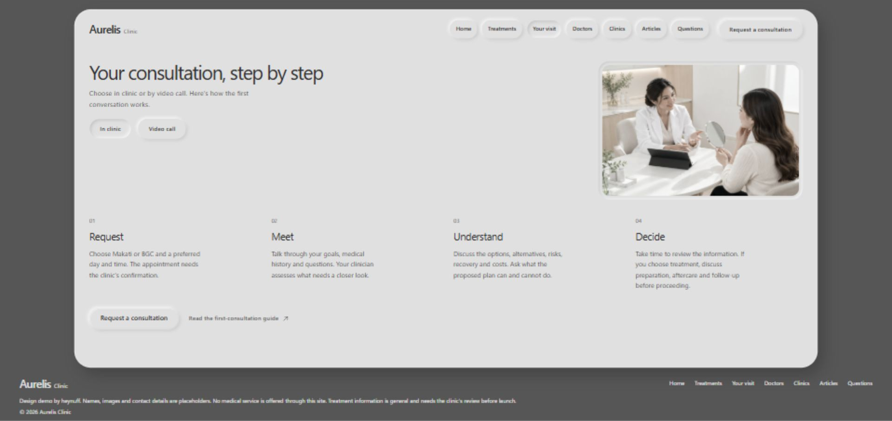

# Aurelis Clinic

A fictional aesthetic and wellness clinic demo by heynuff. Seven pages and an article reader share a sculpted grey interface, with tactile controls and a ten-second illustrated entrance.

[Live demo](https://aurelis-cosmetic-surgery.netlify.app) · [Source](https://github.com/jackbrizuela/aurelis-cosmetic-surgery)



## Run locally

Requires Node.js 24 and pnpm 11.25.0. Dependencies are pinned in pnpm-lock.yaml; the project permits Sharp's required install script in pnpm-workspace.yaml.

```sh
pnpm install --frozen-lockfile
pnpm dev
```

Open http://127.0.0.1:5191/. Build and preview with:

```sh
pnpm build
pnpm preview
```

## Experience

- Home, Treatments, Your visit, Doctors, Clinics, Articles and Questions have direct URLs and browser-history navigation.
- Treatment categories and detail rows, doctor profiles and clinic selections preserve their context.
- In-clinic and video-call walkthroughs feed the consultation request sheet.
- The request flow validates locally and demonstrates Send → confirmation → Done. It sends and stores nothing.
- The illustrated entrance has moving comic thoughts, Skip/Escape support, reduced-motion support and a matching final Home still. It plays on first arrival and on Home refresh, with fail-open handling if playback fails.
- Wide desktop layouts retain the complete outside footer; phones use natural reading and scrolling.

## Source

`index.html` holds page markup. `src/` contains vanilla JavaScript, responsive CSS, navigation, local request behavior and entrance playback. `public/` contains all served images, video and icons. `scripts/` contains the optional Sharp image pipeline; its original image inputs are kept outside this repository. `PRODUCT.md`, `DESIGN.md` and `docs/` describe the demo and its visual decisions.

Vite builds the site; GSAP and Lenis remain declared project dependencies. The served experience needs no third-party API, account or font request. Outbound map and patient-information links open their respective services when followed.

## Hosting

Netlify uses `npm run build` and publishes `dist/`. The included SPA fallback supports refreshing direct routes such as `/your-visit` and `/articles/first-aesthetic-consultation`.

## Demo boundary and assets

Aurelis is fictional. Names, portraits, locations and contact details are illustrative. No medical service, video call or appointment is provided. Treatment information is general and needs clinic review before real use.

The interface uses generated concept photography and an owner-supplied illustrated film edited with HyperFrames. The entry film is upscaled from 720p; its thought overlays render at 1080p. The visual direction draws on minimalist editorial layouts and neumorphic material references. No affiliation with reference designers is implied.

No open-source license is granted by this repository.
